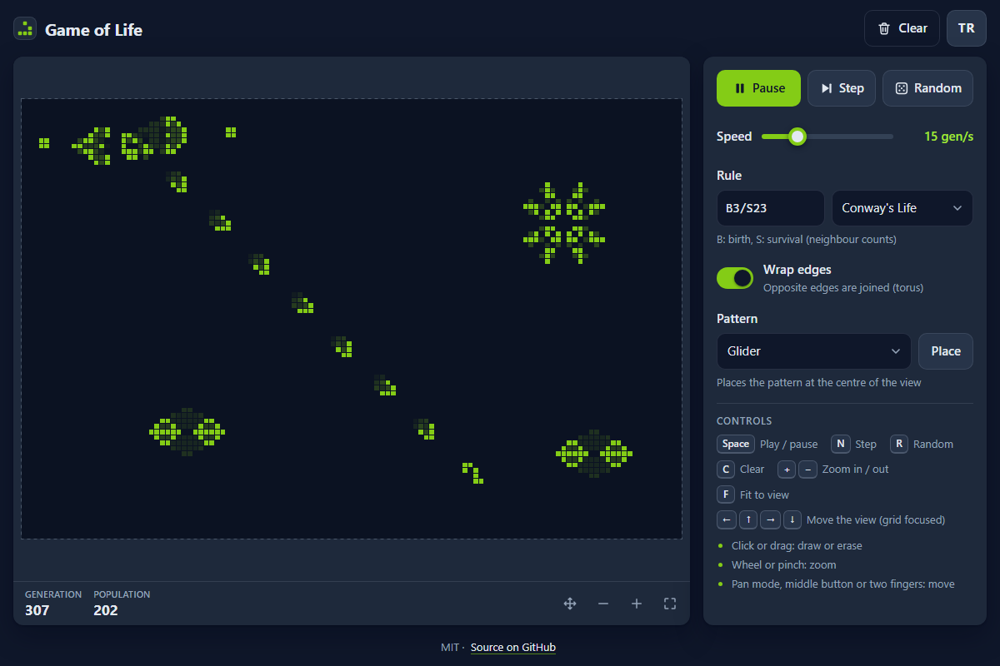

# Game of Life - Conway's cellular automaton to draw on, zoom into and run with other rules

[](#tests)
[](LICENSE)

**▶ Open the app: https://celaldrg.github.io/game-of-life/**



## Features

- A 120 × 80 grid drawn on a canvas that stays sharp on high-DPI screens. The edges either wrap around (a torus) or act as walls.
- Draw or erase with a mouse, pen or finger. Fast strokes leave no gaps, and a touch that turns into a two-finger gesture is undone.
- Zoom with the wheel, a pinch or the buttons. Move the view in pan mode, with the middle mouse button, with two fingers or with the arrow keys.
- Play / Pause, Step, a speed slider from 1 to 60 generations per second, Random and Clear.
- Rules in B/S notation, with presets: Conway's Life (B3/S23), HighLife (B36/S23), Seeds (B2/S) and Day & Night (B3678/S34678).
- Eight built-in patterns: glider, lightweight spaceship, blinker, pulsar, pentadecathlon, Gosper glider gun, R-pentomino and acorn. Each one is placed at the centre of the view.
- Generation and population counters, plus fading trails behind moving cells.
- English and Turkish interface. Your choice is remembered.
- `?demo` opens a running Gosper glider gun with gliders in flight (the screenshot above).
- No dependencies, no build step and no network requests.

## How to use

**Keyboard**

| Key | Action |
| --- | --- |
| Space | Play / pause |
| N | Step one generation |
| R | Random cells |
| C | Clear |
| + / − | Zoom in / out |
| F | Fit the grid to the view |
| Arrow keys | Move the view (while the grid has focus) |

**Mouse and touch**

- Click, tap or drag on the grid to draw. Starting on a live cell erases instead.
- Pinch to zoom and drag with two fingers to move the view. With a mouse, use the wheel to zoom around the pointer.
- On a phone the grid opens zoomed in on its middle, so single cells are easy to tap. The fit button (bottom right of the grid) shows the whole grid.
- Turn on pan mode (the arrows button below the grid) to move the view with one finger or the left mouse button. The middle mouse button always moves it.
- Pick a pattern and press **Place**. It lands at the centre of the view and is briefly outlined.
- Type a rule such as `B36/S23` and press Enter, or pick a preset.

## Run locally

```sh
npx serve .
```

Then open the address it prints. The app uses ES modules, so it has to be served over `http://`. Opening `index.html` as a `file://` URL does not work.

## Tests

```sh
node --test
```

This needs Node 22 or newer and nothing to install. The tests cover:

- B/S rule parsing and the presets
- The seeded random numbers
- The generation step: still lifes, oscillators, spaceships, wrapped and walled edges, other rules
- RLE reading and writing, and the built-in patterns
- Playback timing, speed, settings and editing
- The demo scene
- The camera maths: fit, the zoomed-in first view on phones, zoom around a point, pan limits and resizing
- Stroke lines and undo, and the trails
- The keyboard map and the storage fallbacks
- The English and Turkish string tables, checked against `index.html`

## Project structure

```
index.html            page markup
style.css             styles
src/
  main.js             entry point: game, canvas, controls, animation loop
  game.js             game state: playback, speed, rule, wrap, editing
  grid.js             typed-array grid and the generation step
  rules.js            B/S rules and presets
  rle.js              RLE pattern reader and writer
  patterns.js         built-in patterns
  demo.js             the ?demo scene
  rng.js              seeded random numbers
  view.js             camera maths: fit, zoom, pan
  stroke.js           freehand drawing lines
  trail.js            fading trails
  shortcuts.js        keyboard map
  i18n.js             English and Turkish strings
  storage.js          the only access to localStorage
  renderer.js         canvas drawing
  input.js            pointer, wheel and keyboard events
  panel.js            controls, stats and page translation
test/                 node:test suites
test-support/         helpers shared by the suites
docs/screenshot.png   README screenshot (?demo, 1200 × 800)
```

## License

[MIT](LICENSE) © 2026 Celalettin Durgaç

## Türkçe

**▶ Uygulamayı aç: https://celaldrg.github.io/game-of-life/**

Tarayıcıda Conway'in Hayat Oyunu. Hücre çizebilir, yakınlaştırıp kaydırabilir ve başka kurallarla çalıştırabilirsiniz.

### Özellikler

- Yüksek DPI ekranlarda keskin kalan, canvas üzerinde 120 × 80 bir ızgara. Kenarlar ya birleşir (torus) ya da duvar gibi davranır.
- Fare, kalem ya da parmakla çizme ve silme. Hızlı çizgilerde boşluk kalmaz, iki parmak hareketine dönüşen dokunuş geri alınır.
- Tekerlek, iki parmak ya da düğmelerle yakınlaştırma. Görünümü kaydırma modu, farenin orta tuşu, iki parmak ya da ok tuşlarıyla kaydırma.
- Oynat / Duraklat, Adım, saniyede 1–60 nesil arası hız, Rastgele ve Temizle.
- B/S gösteriminde kurallar ve hazır kurallar: Hayat (Conway, B3/S23), HighLife (B36/S23), Tohumlar (B2/S), Gündüz ve Gece (B3678/S34678).
- Sekiz hazır desen: planör, hafif uzay gemisi, yanıp sönen, pulsar, pentadekatlon, Gosper tabancası, R-pentomino ve meşe palamudu. Seçilen desen görünümün ortasına yerleşir.
- Nesil ve nüfus sayaçları, hareket eden hücrelerin arkasında sönen iz.
- Türkçe ve İngilizce arayüz. Seçiminiz hatırlanır.
- `?demo`, planörleri uçuşta olan, çalışan bir Gosper tabancası açar (yukarıdaki ekran görüntüsü).
- Bağımlılık, derleme adımı ya da ağ isteği yoktur.

### Nasıl kullanılır

**Klavye**

| Tuş | İşlem |
| --- | --- |
| Boşluk | Oynat / duraklat |
| N | Bir nesil ilerlet |
| R | Rastgele hücreler |
| C | Temizle |
| + / − | Yakınlaştır / uzaklaştır |
| F | Izgarayı görünüme sığdır |
| Ok tuşları | Görünümü kaydır (ızgara seçiliyken) |

**Fare ve dokunmatik**

- Çizmek için ızgaraya tıklayın, dokunun ya da sürükleyin. Canlı bir hücreden başlarsanız silersiniz.
- Yakınlaştırmak için iki parmağı açıp kapatın, kaydırmak için iki parmakla sürükleyin. Farede tekerlek, imlecin olduğu yere yakınlaştırır.
- Telefonda ızgara, tek hücrelere kolayca dokunulabilsin diye ortasına yakınlaştırılmış olarak açılır. Sığdır düğmesi (ızgaranın sağ altında) bütün ızgarayı gösterir.
- Görünümü tek parmakla ya da farenin sol tuşuyla kaydırmak için kaydırma modunu açın (ızgaranın altındaki oklu düğme). Farenin orta tuşu her zaman kaydırır.
- Bir desen seçip **Yerleştir**'e basın. Desen görünümün ortasına gelir ve kısa bir süre çerçeveyle gösterilir.
- `B36/S23` gibi bir kural yazıp Enter'a basın ya da hazır bir kural seçin.

### Yerelde çalıştırma

```sh
npx serve .
```

Ardından yazdığı adresi açın. Uygulama ES modülleri kullandığı için `http://` üzerinden sunulmalıdır. `index.html` dosyasını `file://` ile açmak çalışmaz.

### Testler

```sh
node --test
```

Node 22 ya da üstü gerekir, kurulacak bir şey yoktur. Testler şunları kapsar:

- B/S kural ayrıştırma ve hazır kurallar
- Tohumlu rastgele sayılar
- Nesil adımı: durağan yapılar, salınıcılar, uzay gemileri, birleşik ve kapalı kenarlar, diğer kurallar
- RLE okuma ve yazma, hazır desenler
- Oynatma zamanlaması, hız, ayarlar ve düzenleme
- Demo sahnesi
- Kamera hesapları: sığdırma, telefonlarda yakınlaştırılmış ilk görünüm, bir noktanın çevresinde yakınlaştırma, kaydırma sınırları ve yeniden boyutlandırma
- Çizgi çizme ve geri alma, iz
- Klavye eşlemesi ve depolama yedekleri
- `index.html` ile karşılaştırılan İngilizce ve Türkçe metin tabloları

### Lisans

[MIT](LICENSE) © 2026 Celalettin Durgaç
